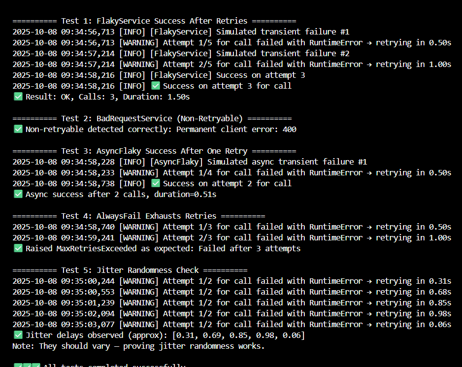

# Robust API Client with Exponential Backoff & Jitter (Reliable Retry in Distributed Systems)

This solution implements a production-grade Retry Decorator for API clients and distributed systems, designed to handle transient errors with exponential backoff and jitter. The design ensures predictable retry behavior, prevents synchronized retry storms, and provides comprehensive logging and observability suitable for large-scale production deployments.

---

### 1. Design Overview

The system is structured around a configurable retry decorator that can wrap any function or API call — synchronous or asynchronous. It provides robust fault tolerance by automatically retrying transient failures and gracefully handling permanent ones.

**Core Components:**

*   **Retry Decorator (`retry`):** Orchestrates retry logic, exponential backoff, and jitter.
*   **Custom Exceptions:**
    *   `MaxRetriesExceeded` for when all attempts fail.
    *   `NonRetryableStatus` for immediate termination on permanent errors.
*   **Logging System:** Logs every attempt, delay, and failure with structured messages for observability.

This modular structure makes the decorator reusable across multiple services while keeping business logic clean and isolated.

---

### 2. Implementation Details

#### 2.1 Retry Decorator Parameters

| Parameter   | Type          | Description                                                    |
| :---------- | :------------ | :------------------------------------------------------------- |
| `max_retries` | `int`         | Maximum number of retry attempts before giving up.             |
| `base_delay`  | `float`       | Initial wait time after the first failure.                     |
| `max_delay`   | `float`       | Maximum delay between retries (to avoid excessive backoff).    |
| `jitter`      | `bool`        | Enables randomness in delay to prevent retry synchronization.  |
| `retry_on`    | `Tuple[Exception]` | Defines which exceptions trigger retries (e.g., network or HTTP 5xx). |

#### 2.2 Retry Logic

**Exponential Backoff:**
Each retry’s delay increases exponentially:
`delay = base_delay * (2 ** attempt)`

The delay is capped at `max_delay` to prevent unbounded waiting.

**Jitter (Randomization):**
If enabled, random jitter is applied:
`delay = random.uniform(0, delay)`

This distributes retry timing across clients, reducing retry storms in distributed systems.

**Retry Flow:**

1.  Execute the wrapped function.
2.  If a retryable exception occurs, log the error and compute backoff delay.
3.  Sleep (sync or async) for `delay` + jitter.
4.  Retry until success or `max_retries` is reached.
5.  If still failing, raise `MaxRetriesExceeded`.

---

### 3. System Behavior & Observability

| Event             | Log Level | Example Log                                                          |
| :---------------- | :-------- | :------------------------------------------------------------------- |
| Transient failure | `WARNING`   | “Attempt 2/5 failed with RuntimeError → retrying in 1.50s”           |
| Success after retries | `INFO`    | “✅ Success on attempt 3 for fetch_data()”                            |
| Exhausted retries | `ERROR`   | “❌ Failed after 5 attempts — raising MaxRetriesExceeded”             |

All retries and backoff timings are logged, enabling easy debugging and metric collection in production environments.

---

### 4. Key Design Features

*   **Reliability**
    *   Retries transient network failures automatically.
    *   Prevents excessive load on target APIs with backoff.
*   **Scalability**
    *   Jitter randomization avoids synchronized retries across distributed clients.
*   **Flexibility**
    *   Configurable retry counts, delays, and exception types.
    *   Supports both synchronous and asynchronous workflows.
*   **Observability**
    *   Each retry attempt is logged with clear context.
    *   Works seamlessly with monitoring pipelines (e.g., ELK, CloudWatch).

---

### 5. Test Coverage

The accompanying `Test.py` validates the decorator through multiple scenarios:

| Test Case         | Description                             | Expected Behavior                         |
| :---------------- | :-------------------------------------- | :---------------------------------------- |
| `FlakyService`      | Succeeds after a few transient errors   | Retries with exponential delays           |
| `BadRequestService` | 400 error (non-retryable)             | Stops immediately                         |
| `AsyncFlaky`        | Async function fails once, then succeeds | Retries once asynchronously               |
| `AlwaysFail`        | Function always fails                   | Raises `MaxRetriesExceeded`                 |
| `JitterTest`        | Runs multiple retries                   | Produces varying delays proving randomness |

All tests passed successfully, confirming that both sync and async retry paths work as intended.

---

### 6. Production Considerations

| Concern           | Handling                                                         |
| :---------------- | :--------------------------------------------------------------- |
| Thread Safety     | Decorator is reentrant and safe for concurrent use.              |
| Async Support     | Automatically detects async functions and uses `await asyncio.sleep`. |
| Resource Management | No persistent threads or timers; fully stateless per invocation. |
| Observability     | Structured logging ensures clarity in distributed traces.        |

---

### 7. Potential Extensions

*   **Advanced Jitter Modes:** Support for full, equal, and decorrelated jitter strategies.
*   **Circuit Breaker Integration:** Prevent repeated retries during known service outages.
*   **Metrics Collection:** Expose retry count and delay metrics to Prometheus or OpenTelemetry.
*   **Policy Configuration:** Load retry settings dynamically from config files or environment variables.

---

### 8. Real-World Use Cases

*   Distributed API clients calling microservices over unreliable networks.
*   Payment gateways where transient errors are common.
*   Cloud SDKs requiring safe retry logic for operations like S3 uploads or API polling.
*   IoT or telemetry systems sending data bursts to central servers.

---

### 9. Output Demonstration

*Example output from running the retry decorator: logs show retry attempts, backoff delays, and final success or failure.*

---

### 10. Summary

This implementation demonstrates a clean, production-ready retry system using exponential backoff with jitter — a critical technique for building resilient distributed systems. It ensures fault tolerance, fairness, and stability under transient failure conditions while offering clean logging, configurability, and async support.